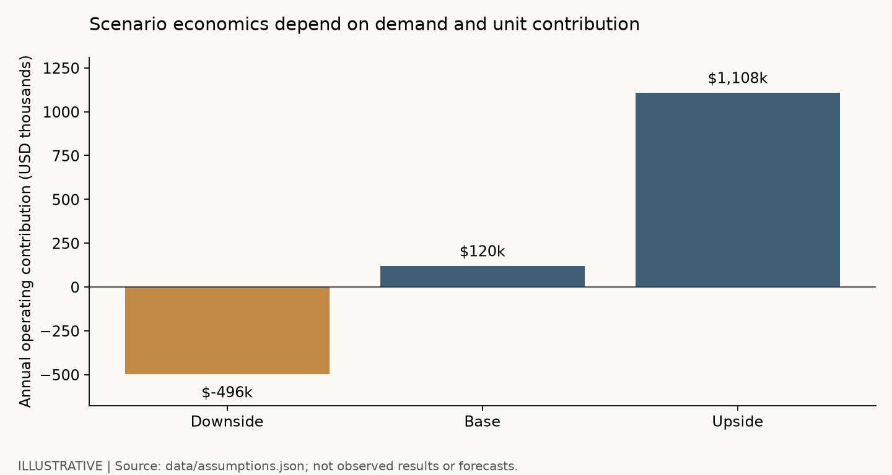
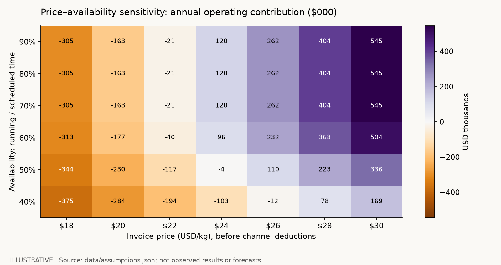
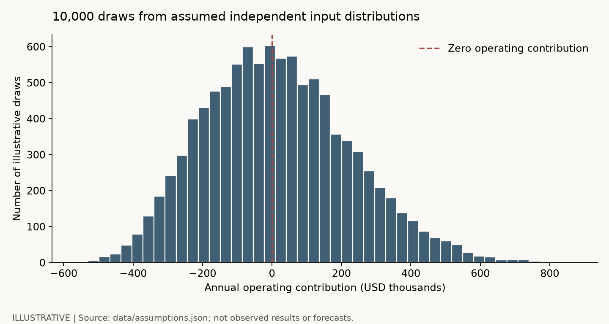

# Printed Meat | Business Analytics Research Lab
**Lexi Loughlin · M.S. Business Analytics, SMU Cox**

An editable, reproducible research portfolio investigating **when 3D food structuring creates a commercially viable meat alternative**. Combines evidence appraisal, competitive intelligence, manufacturing economics, capacity-constrained demand, uncertainty analysis, and a primary-research design.

**Research review: October 20, 2026.** Sources have individual review dates; this is not a certification that all industry or legal developments are captured. All financial model inputs are illustrative analyst assumptions, not company financials or market forecasts.

## Start here

| Reader | Open |
|---|---|
| Recruiter / presentation audience | [Executive research brief](research/01-executive-brief.md) |
| Industry researcher | [Technology and competition](research/02-technology-competition.md) |
| Business analyst | [Commercial model and assumptions](research/03-commercial-model.md) |
| Research reviewer | [Evidence audit and limitations](research/04-evidence-audit.md) |
| Growth / consumer insights analyst | [Consumer research and experiments](research/05-consumer-experiments.md) |
| Strategy / operations analyst | [Market entry, KPIs, and risks](research/06-strategy-kpis.md) |
| Presenter | [10-minute presentation outline](research/07-presentation.md) |
| VS Code user | [Reproducible notebook](notebooks/commercial-analysis.ipynb) · [Setup](CONTRIBUTING.md) |

## The decision

Should a hypothetical operator test a **plant-based printed whole-cut product in a focused foodservice channel**, and which evidence would justify expansion? The United States is the model's commercial setting; Germany provides contextual survey evidence only. Cultivated printed meat is a separate technology and regulatory track. No global printed-meat TAM is asserted.

## What this portfolio demonstrates

- Research provenance: claim-level source ledger, explicit evidence classes, and a legacy-data audit.
- Business analytics: account-based opportunity sizing, demand/capacity reconciliation, unit contribution, operating break-even, working capital, and five-year NPV.
- Uncertainty: coherent downside/base/upside cases, price–utilization sensitivity, reproducible Monte Carlo exploration, and an explicit distinction between scenarios and predictions.
- Decision design: buyer interviews, randomized sensory testing, price experiments, cohort-based repeat purchase, and commercial stage gates.
- Engineering practice: configurable JSON inputs, reusable Python calculations, SQL schema, automated financial invariants, and GitHub Actions.

## Run locally in VS Code

```bash
python -m venv .venv
# macOS / Linux
source .venv/bin/activate
# Windows PowerShell: .venv\Scripts\Activate.ps1
python -m pip install -r requirements.txt
python analysis/run_analysis.py
python -m unittest discover -s tests -v
jupyter lab notebooks/commercial-analysis.ipynb
```

The core analysis and tests use Python's standard library. Notebook and chart tools use the packages in `requirements.txt`. Run commands from the repository root. VS Code: open this folder, select the `.venv` Python interpreter, and install Microsoft's Python and Jupyter extensions to edit the notebook.

## Generated analytical exhibits

All exhibits below represent **illustrative scenarios**, not observed industry results. Rebuild them from `data/assumptions.json`.





Exact outputs: [scenario results](results/scenarios.csv), [sensitivity](results/price_utilization.csv), [simulation summary](results/simulation_summary.json), [generated summary](results/summary.md).

## Evidence before forecasting

The original repository's survey and market estimates are retained for continuity. Important qualifications:

1. Bitkom's 24% result is stated openness to **cultivated printed meat among German residents aged 16+**, not US purchasing conversion or plant-based demand. The 2019 comparator is reported retrospectively in the 2025 release.
2. Published market-report figures use different years and scopes. Their ratio is an arithmetic comparison, not an uncertainty interval or proof that either publisher is wrong.
3. Announced printer throughput is a supplier claim; it does not measure saleable output, utilization, sales, or profit.
4. A planned product launch is not a completed launch. Company pages establish what companies say, not independent market traction.
5. Texas's enrolled statute establishes its provisions and scheduled dates. A current court order and updated law check are needed before asserting present enforceability. Legacy state rows are a selected historical sample, not a 50-state legal database.

[Reviewed source ledger](data/evidence_ledger.csv) · [Legacy narrative](docs/original-research.md) · [Legacy GitHub Pages presentation](docs/index.html)

## Repository map

```text
research/       seven research and presentation chapters
analysis/       commercial model, reproducible runner, legacy chart builder
notebooks/      editable analytical companion
data/          sourced legacy CSVs, evidence ledger, illustrative assumptions
results/        generated model outputs (never manually edited)
charts/         generated exhibits plus clearly labeled historical exhibits
sql/            research database schema and analytical queries
tests/         economic and data-contract checks
.github/        reproducibility workflow
```

## Limits and next research priorities

This is a research portfolio and decision framework, not investment advice or a complete industry census. Public evidence does not establish industry-wide unit cost, realized throughput, printed-product repeat purchase, or a reliable printed-meat market size. Replace illustrative inputs with supplier quotes, measured production runs, and a consented buyer pilot before making a capital decision. See [the research backlog](research/08-research-backlog.md).
