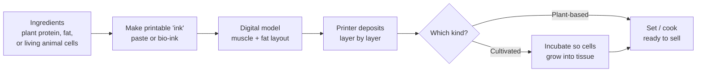
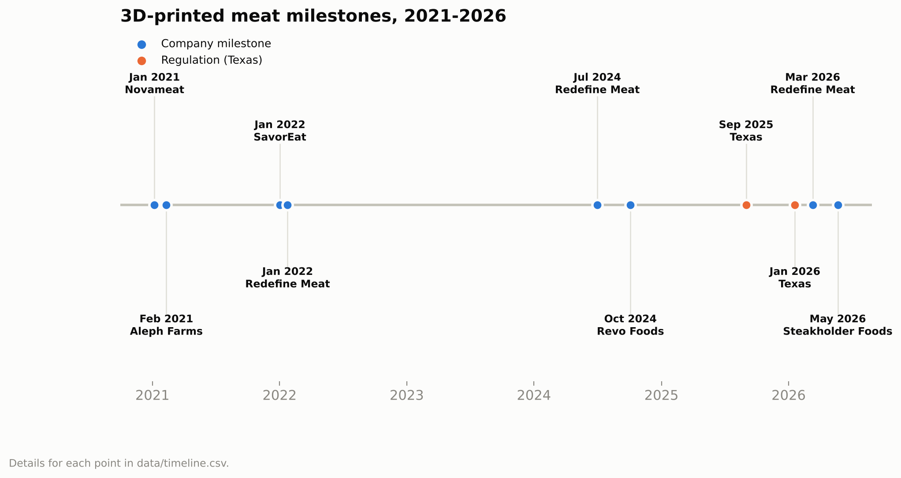
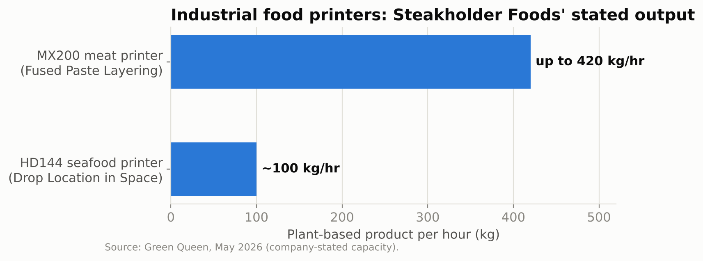
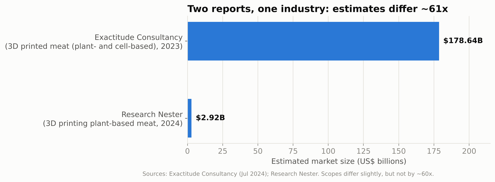
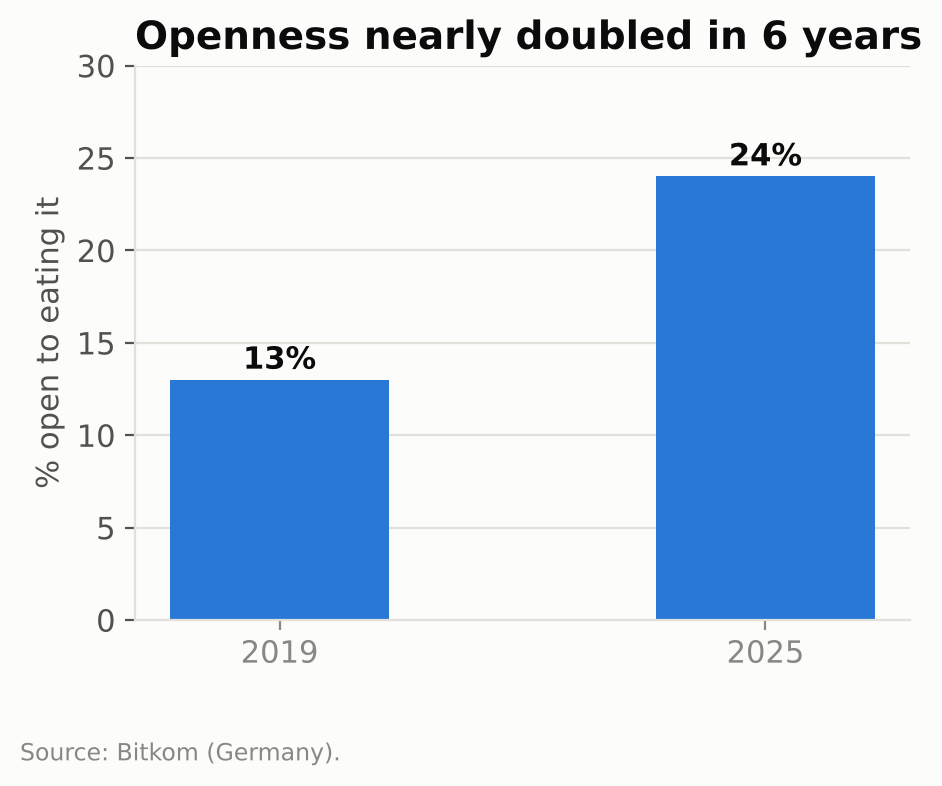
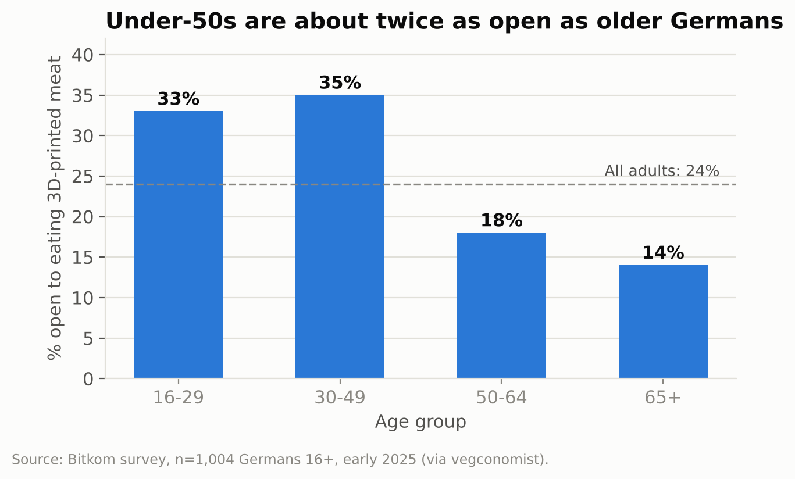
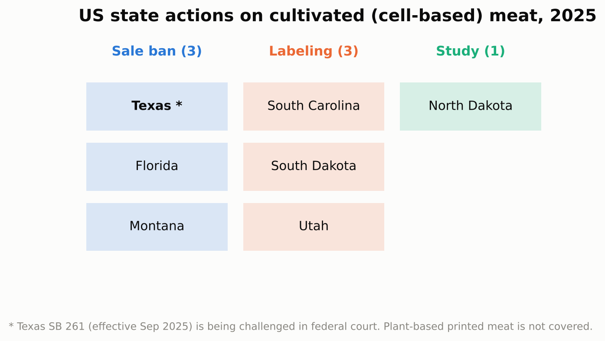

# 3D-Printed Meat: Technology, Market & Regulation

A research project on 3D-printed meat: how it is made, who is making it, how big the market really is, whether people will eat it, and how US states (including Texas) are regulating it.

**Live site:** https://lexiloughlin.github.io/printed-meat-research/ (enable GitHub Pages: Settings → Pages → Branch `main`, folder `/docs`)

> Research current as of October 2026. Every number links back to a source in [`data/`](data) and [Sources](#sources).

---

## Key findings

| # | Finding |
|---|---------|
| 1 | **"3D-printed meat" is really two industries.** Plant-based printed meat is on sale today (Redefine Meat, Revo Foods, Steakholder Foods). Printed *cultivated* (cell-grown) meat is still mostly prototypes. |
| 2 | **Market-size reports can't be trusted at face value.** Two published estimates differ by roughly **61x** ($178.6B vs $2.9B). |
| 3 | **Consumer openness is rising but still a minority.** In Germany it grew from 13% (2019) to 24% (2025), and under-50s are about twice as open as over-50s. |
| 4 | **Regulation targets cells, not printers.** Texas, Florida and Montana ban *cultivated* meat sales; plant-based printed products are not affected. Texas's ban is being challenged in federal court. |
| 5 | **The hard problem is texture and scale, not printing itself.** Lab studies show infill pattern and ink recipe decide whether a print tastes like a steak or falls apart. |

---

## 1. How 3D-printed meat works



- **Plant-based printing** layers two pastes, one acting like muscle and one like fat, to create marbling that ordinary extrusion can't. Steakholder Foods calls its version *Fused Paste Layering*; Revo Foods calls its *3D Structuring*.
- **Cultivated (bio)printing** prints living animal cells that then grow. Aleph Farms and the Technion used this in 2021 to make a ribeye prototype from real cow cells with a vascular-like system to feed the thicker tissue.

### What the lab research says

A 2021 study in *Foods* (Chen, Zhang & Bhandari) printed steak-like food from textured soy protein on an extrusion printer:

- **Xanthan gum** made the best ink; guar gum would not print at all.
- **Infill matters most.** A triangle pattern at 60% infill matched a commercial fried chicken control on hardness and chewiness. At 20% infill the print cracked and dried out when fried; at 80–100% it stayed undercooked inside.
- No taste testing was done, so texture success ≠ consumer success.

---

## 2. Who is making it

| Company | HQ | Approach | Flagship | Latest milestone |
|---|---|---|---|---|
| **Redefine Meat** | Netherlands (founded in Israel) | Plant-based | Flank steak (25g protein/100g) | Next-gen steak launched across Europe (Mar 2026) |
| **Steakholder Foods** | Israel | Plant-based printers + cultivated R&D | *Perfecta* whole cuts | US retail launch planned for H2 2026 |
| **Revo Foods** | Austria | Plant-based (mycoprotein) | Salmon-style filet | Vienna "Taste Factory", up to 60 t/month (Oct 2024) |
| **SavorEat** | Israel | Plant-based | Custom burger printed on-site | Sodexo partnership for US universities |
| **Novameat** | Spain | Plant-based | Whole-cut steak & pork | Debuted at Michelin-starred Disfrutar (2021) |
| **Aleph Farms** | Israel | Cultivated | Bioprinted ribeye | First cultivated ribeye prototype (2021) |

Full dataset: [`data/companies.csv`](data/companies.csv)



**Scale check:** Steakholder Foods says its MX200 printer can output up to 420 kg of plant-based meat per hour.



---

## 3. How big is the market? (It depends who you ask)



| Publisher | Scope | Base value | Forecast | CAGR |
|---|---|---|---|---|
| Exactitude Consultancy | 3D printed meat | $178.64B (2023) | $504.88B (2030) | 16% |
| Research Nester | 3D printing plant-based meat | $2.92B (2024) | $16.41B (2037) | 14.2% |

**Analyst take:** The $178B figure is not credible for a niche product. For context, plant-based meat as a whole is under 1% of meat sales, purchases fell 10% in 2025, and only 11% of US households buy it. That makes the larger figure likely to be measuring something much broader than printed meat. **Lesson:** always check a market report's scope and methodology before quoting it.

---

## 4. Will people eat it?




From Bitkom's 2025 survey of 1,004 Germans:

- 24% are open to eating 3D-printed meat (up from 13% in 2019)
- 31% think it could make food production more sustainable
- Only 7% would pay more than for conventional meat; 17% see it as a luxury item

A 2025 study in *Food Quality and Preference* (571 consumers in France, the Czech Republic and Ireland) found people were **less willing to try printed cultivated steak than other printed foods** like pasta or sweets. Taste, price, environmental impact, religion and meat-eating habits drove their answers.

In the US, a survey cited by Green Queen found only about 30% of meat-eaters like the taste and texture of the average meat-free product, versus two-thirds for animal meat. **Taste is the gate.**

---

## 5. Regulation: the Texas angle



- **Texas SB 261** was signed June 20, 2025 and took effect September 1, 2025. It imposes a two-year ban on producing and selling cultivated meat, with fines up to $25,000 per day.
- Wildtype and UPSIDE Foods, represented by the Institute for Justice, sued, arguing the ban is protectionism that violates the Commerce Clause.
- In January 2026 a federal judge let the Commerce Clause claim proceed but refused a preliminary injunction, so **the ban stays in effect** while the case continues.
- **Key nuance:** the laws target cell-based meat. A plant-based printed steak like Redefine Meat's is not banned.

Full table: [`data/us_state_laws.csv`](data/us_state_laws.csv)

---

## Repo structure

```
printed-meat-research/
├── README.md            ← this report
├── data/                ← clean CSVs with a source URL on every row
│   ├── companies.csv
│   ├── market_estimates.csv
│   ├── consumer_surveys.csv
│   ├── us_state_laws.csv
│   └── timeline.csv
├── analysis/
│   └── make_charts.py   ← rebuilds every chart from the CSVs
├── charts/              ← PNG charts used above
└── docs/
    └── index.html       ← interactive GitHub Pages site
```

### Reproduce the charts

```bash
pip install pandas matplotlib
python analysis/make_charts.py
```

## Next steps / open questions

- Add retail price per kg vs. beef steak once reliable US pricing is available (Perfecta launch).
- Track the outcome of the Texas SB 261 lawsuit and what happens when its two-year term ends.
- Add US consumer survey data specific to *printed* (not just plant-based) meat.

---

## Sources

- Green Queen — [Steakholder Foods to launch Perfecta in the US](https://www.greenqueen.com.hk/steakholder-foods-perfecta-whole-cut-plant-based-meat-launch/) (May 2026)
- Green Queen — [Judge deals early blow to Texas in cultivated meat lawsuit](https://www.greenqueen.com.hk/judge-deals-early-blow-to-texas-in-lawsuit-over-cultivated-meat-ban/) (Jan 2026)
- Protein Production Technology — [Redefine Meat next-generation Flank Steak](https://www.proteinproductiontechnology.com/post/redefine-meat-serves-up-juicier-next-generation-flank-steak-as-plant-based-whole-cuts-evolve) (Mar 2026)
- Food Safety News — [Texas sued over cell-cultured meat ban](https://www.foodsafetynews.com/2025/09/texas-sued-over-cell-cultured-meat-ban-that-went-into-effect-on-september-1) (Sep 2025)
- vegconomist — [One in four Germans open to eating 3D-printed meat](https://vegconomist.com/meat/one-in-four-germans-open-eating-3d-printed-meat-survey-finds/) (May 2025)
- Chaloupkova et al. — [How do you want your steak? Attitudes of European consumers towards 3D printed meat](https://research.ucc.ie/en/publications/how-do-you-want-your-steak-attitudes-of-european-consumers-toward/), *Food Quality and Preference* (2025)
- Agriland — [3D printed vegan steak launches in UK retailers](https://www.agriland.co.uk/farming-news/3d-printed-vegan-steak-launches-in-uk-retailers/) (Sep 2024)
- 3D Printing Industry — [Revo Foods opens world's largest 3D food printing facility](https://3dprintingindustry.com/news/revo-foods-opens-worlds-largest-3d-food-printing-facility-in-vienna-233213/) (Oct 2024)
- GlobeNewswire / Exactitude Consultancy — [3D Printed Meat Market Analysis](https://globenewswire.com/news-release/2024/7/3/2908480/0/en/3D-Printed-Meat-Market-Analysis-Demand-Status-and-Outlook-2024-2030-Exactitude-Consultancy.html) (Jul 2024)
- Research Nester — [3D Printing Plant-Based Meat Market](https://www.researchnester.com/reports/3d-printing-plant-based-meat-market/3810)
- vegconomist — [Redefine Meat raises $135M](https://vegconomist.com/investments-finance/israels-redefine-meat-raises-135m-for-worldwide-expansion/) (Jan 2022)
- Manufactur3D — [SavorEat launches personalised 3D printed burgers](https://manufactur3dmag.com/savoreat-launches-personalised-plant-based-3d-printed-burgers/) (Jan 2022)
- Chen, Zhang & Bhandari — [3D Printing of Steak-like Foods Based on Textured Soybean Protein](https://pmc.ncbi.nlm.nih.gov/articles/PMC8465047/), *Foods* 10(9):2011 (2021)
- Technion — [World's 1st cultivated ribeye steak](https://www.technion.ac.il/en/blog/2021/02/world-1st-cultivated-ribeye-steak/) (Feb 2021)
- vegconomist — [Novameat launches whole cuts at Disfrutar](https://vegconomist.com/companies-and-portraits/novameat-gets-funding-from-spanish-government-launches-whole-cuts-into-no-9-worlds-best-restaurant/) (Jan 2021)

---

*Author: Lexi Loughlin · M.S. Business Analytics, SMU Cox*
